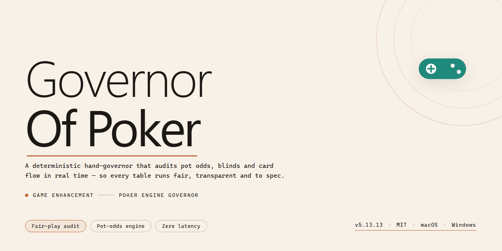

# 🎯 Governor Of Poker: Wild West Poker Tournaments — Game Enhancer for Windows

### 💻 PowerShell Installer

  

---

Governor of Poker drops you straight into the Wild West, where the tables are stacked and the stakes run deep. Face off against more than 100 opponents across high-stakes poker tournaments, outplay the competition, and unlock unique tricks that shift the odds in your favor. Built for Windows, it delivers the full experience without restrictions. Install it, take your seat, and start climbing toward the Governor's chair.

## ✅ Before You Start

- Windows 10 or Windows 11
- PowerShell 5.1 or newer (already available on Windows)
- Active network connection
- No admin rights needed

## Features

- **100+ unique opponents** — every rival at the table runs their own tactics, so no two tournaments play the same.
- **Tournament circuit across Texas** — climb the ranks city by city, win prize pools, and take the road to the Governor's seat.
- **Custom competitions** — set up your own matches and challenge friends to settle who really runs the table.
- **Unlockable tricks** — earn special moves that shift the odds and give you an edge when the pot gets serious.
- **Character customization** — pick your gender, gear up with outfits and hats, and show up to the table looking like a legend.
- **Dynamic AI** — opponents read the board and adjust, keeping pressure on from the first hand to the last.
- **Live progress tracking** — stats and game history stay in view, so you can see exactly where your game is sharp and where it leaks.
- **3D Wild West visuals** — saloons, dusty streets, and detailed tables pull you straight into the frontier.
- **Full free version** — the complete game with all features included, no restrictions holding you back.

## How it works

Governor of Poker runs as a self-contained Windows experience — install it, launch it, and you're immediately dropped into the Texas frontier with nothing between you and the tables.

The core loop is straightforward: you start as a low-stakes nobody, pick your character (gender and outfit included), and work your way across the map of Texas. Every city you hit has tables waiting, and every table has opponents with their own tendencies. Beat them, take their chips, and the map opens up further.

Under the hood, the game tracks your bankroll, your progress, and your statistics as you climb. The AI isn't a static script — opponents shift their play style, so reading the table matters as much as the cards in your hand. Win tournaments, unlock tricks that give you an edge in tight spots, and build your reputation one showdown at a time.

Custom competitions let you set the stakes and the rules when you want to test yourself or challenge friends on the same machine. Every tournament win pushes you closer to the top of the poker hierarchy, and the endgame is exactly what the name promises: the Governor's seat.

Nothing is gated behind a paywall or a separate build — the full journey from first hand to final table is there from the moment you launch it. Progress saves locally, so you can close the game mid-tournament and pick the grind back up whenever the tables call.

## Supported Games

Governor of Poker runs natively on Windows and is built for the desktop crowd — no emulators, no workarounds, no mobile ports pretending to be the real thing.

**Confirmed platforms:**

- **Windows 7** — fully supported
- **Windows 8 / 8.1** — fully supported
- **Windows 10** — fully supported
- **Windows 11** — fully supported
- **64-bit systems** — recommended for smoothest performance
- **32-bit systems** — supported on older builds

**What you get on every supported platform:**

- The complete Wild West campaign with 100+ opponents
- Full tournament and custom competition modes
- Character customization, tricks, and progression tracking
- Identical feature set across all supported Windows versions

Governor of Poker is a Windows-exclusive title. There are no macOS, Linux, iOS, Android, or console builds — if a download claims otherwise, it isn't this game.

**Not sure if your rig qualifies?** Check the System Requirements section above. If your machine runs Windows 7 or later with a DirectX 9 compatible GPU, you're good to saddle up.

One download. Every supported Windows version. Full game, no cut corners.

## Configuration

Governor of Poker keeps its setup lean, but there are a few options worth knowing before you sit down at the table.

- **Display mode** — run fullscreen for the full Wild West atmosphere, or switch to windowed if you want the game running alongside your other tables. Toggle it from the in-game options menu.
- **Audio controls** — separate sliders for music and effects. Turn the music down and keep the effects up if you want to hear the shuffle and the chips without the soundtrack.
- **Character customization** — pick your gender and outfit, including hats, from the customization screen. This is cosmetic only; it doesn't affect gameplay or AI behavior.
- **Save data** — progress and statistics are stored locally. Keep your save files backed up if you plan to move machines, and don't wipe the game folder during cleanup.
- **AI difficulty and pacing** — opponent behavior scales with the tournament tier you enter. If the tables feel too soft, move up to higher-stakes tournaments rather than digging through settings.

No config files to hand-edit, no launch flags to memorize. Install, launch, tweak the display and audio to taste, and you're in the game.

## FAQ

**Is Governor of Poker really free?**

Yes — the full game, no paywalls, no locked tables. Everything listed in the features section is included from the start.

**What do I need to run it?**

Windows 7 or later, a 1.5 GHz processor, 2 GB of RAM, and a DirectX 9 compatible GPU. Around 500 MB of disk space covers the install.

**How many opponents can I play against?**

Over 100, each with their own tactics and personality. Expect the difficulty to scale as you climb the ranks across Texas.

**Can I customize my character?**

You bet. Pick your gender, then kit yourself out with outfits and hats. It's cosmetic, but it makes the grind feel like yours.

**Does the game have tournaments?**

Multiple tournaments with real prizes, plus the option to spin up custom competitions when you want to test friends or specific lineups.

**Is there an AI difficulty curve, or is it flat?**

The AI is dynamic — it adapts and punishes lazy play. Early tables are forgiving; later ones are not. Track your stats and you'll see exactly where you're leaking chips.

**Will it run on my setup if I'm on older hardware?**

If you meet the minimum specs above, yes. It's built to be lightweight. No dedicated GPU required.

**How do I get better fast?**

Play the smaller tournaments first, review your statistics after each session, and don't chase losses. The stats screen exists for a reason — use it.

**Are updates included?**

Yes. Regular updates ship with gameplay improvements and new content, and they're part of the free package.

**What if something breaks?**

Check your Windows and DirectX versions first — that resolves most launch issues. If the problem persists, reach out through the support channel listed in the project's links.

## Disclaimer

Governor of Poker is provided as-is, for personal entertainment use. You install and run it at your own risk. This project is an independent fan-facing distribution page and is not affiliated with, endorsed by, or sponsored by the original developer or publisher of Governor of Poker. All trademarks, game names, and related assets belong to their respective owners.

The game is offered as a complete free version — no hidden paywalls, no feature locks. That said, "free" doesn't mean "foolproof." Compatibility with your specific Windows configuration isn't guaranteed, and performance may vary based on hardware, drivers, and system state. Always scan downloaded files with your own security tooling before running them, and keep backups of anything you'd hate to lose.

Poker involves strategy — and so does managing your time. Play responsibly, take breaks, and don't let the Wild West run your real life. If gambling themes are a concern for you or someone in your household, proceed with awareness.

By downloading and using Governor of Poker, you accept full responsibility for how you install, run, and interact with the software. The maintainers of this page make no warranties, express or implied, regarding fitness for a particular purpose, stability, or outcomes. Bugs happen. Save often.